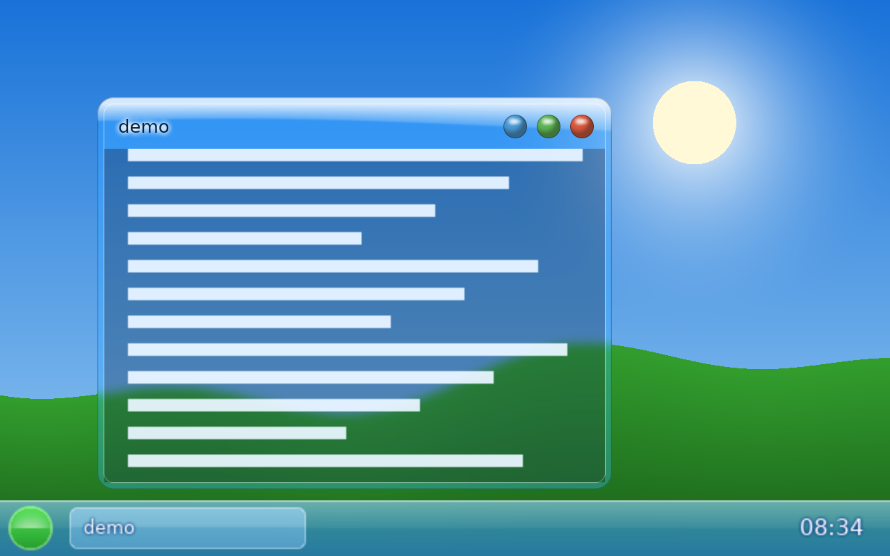

# FDE: Frutiger Desktop Environment

[](https://github.com/L0rdr-ln/FDE/actions/workflows/build.yml)


A Wayland desktop in the **Frutiger Aero** style: glass windows that really blur what is behind
them, gloss on the title bars, orb buttons, a sky-and-hills wallpaper, a glass task bar and start
menu. The goal is a complete desktop suite the way GNOME or KDE are (compositor, shell, settings,
theme, session), built in stages. Today: the compositor, a task bar with start menu and window
list, and a lock screen.

Written in Rust on [Smithay](https://github.com/Smithay/smithay), **not** on wlroots: wlroots'
scene graph can only stack pictures and rectangles, it cannot read back what is behind a window,
so a true blur is impossible there. FDE draws the scene bottom to top into an offscreen
texture, and before every glass window it blurs the part of that texture behind the window (dual
Kawase blur), draws the glass panel over it (rounded shape, tint, gloss, light edge) and then
the client. Clients can ask for the same blur behind their own translucent areas with
`ext-background-effect-v1`.


| start menu | lock screen | notifications |
|---|---|---|
|  |  |  |

## What works

| | |
|---|---|
| **Compositor** | xdg-shell windows with server-side glass frames, move / resize / maximize / minimize, wobbly windows (spring-bent while dragged), fullscreen, pointer lock for games, XWayland (X11 programs get the same glass frames), screen capture (wlr-screencopy), clipboard and primary selection (middle-click paste) between Wayland and X11 programs, fractional scaling, dmabuf, idle inhibit, focus, popups, keyboard and pointer; layer-shell (panels, launchers, wallpapers) with exclusive zones; `ext-background-effect-v1`; `ext-session-lock-v1`; `wlr-foreign-toplevel-management`; nested (winit) backend and a DRM/KMS backend |
| **Cursors** | the mouse cursor comes from your XCursor theme (`appearance.cursor_theme`/`cursor_size`, or `$XCURSOR_THEME`), at the monitor's scale; clients can ask for named cursors (text beam, hand ...) or draw their own; resize arrows on window borders. The nested window uses the host's cursor |
| **Task bar** `fde-panel` | glass strip with the start orb, a button per open window (click to raise or minimize), clock; blurred behind |
| **Start menu** | the installed applications from `.desktop` files with a search field: type to filter, Up/Down, Enter starts, Esc clears or closes; glass sheet, closes when the pointer leaves |
| **Notifications** `fde-notify` | the `org.freedesktop.Notifications` service on the session bus (what `notify-send` and every app talks to); glass bubbles at the top right, newest on top, expire on their timeout, critical ones stay, click to dismiss; started with the session when a D-Bus session bus exists |
| **Themes** | `appearance.theme`: the six members of the Frutiger family: Frutiger Aero (default), Metro, Eco, Dorific, Vector Flourish and Aqua; your own as a small TOML file, see `docs/THEMES.md`. A theme sets the glass, the frame sizes, the buttons, the wallpaper and the colours of the task bar, menu, lock screen and notifications |
| **Settings** `fde-settings` | GTK4 control panel with the FDE look: accent colour, glass tint, blur, gloss, wallpaper (a PNG, JPEG or WebP, with fill / fit / stretch / center / tile), keyboard layout and repeat, terminal, task bar, idle lock. Every change is written to `fde.toml` (comments kept, bad values refused) and the running desktop follows at once. Build it with `cargo build -p fde-settings` (needs `libgtk-4-dev`) |
| **Music** `fde-music` | background music from your own files (`[music]` in the config, or the Music page in settings): plays a file or a folder in a loop, volume, shuffle; follows the config live. Off by default, nothing is bundled. `fde-music --check FILE` says whether a file plays. Needs a sound card and `libasound2-dev` to build |
| **Lock screen** `fde-lock` | `Alt+L`: a glass login card; the password is checked by PAM's `unix_chkpwd` |
| **Tests** | pixel tests of the glass on a software GL, and end-to-end tests with real Wayland clients (including the real panel and lock programs); no display or GPU needed |

**Multi-monitor and HiDPI:** several outputs side by side in one space, each with its own scale
(`[outputs.NAME]` in `fde.toml`: scale, mode, position, on/off); windows can be on or across
any of them, the pointer moves between them, maximize fills the monitor the window is on, the
lock screen covers every monitor. Tested with virtual outputs (two monitors; a 2x monitor draws
the frame, title and client at double size). Every monitor gets its own task bar (with the same window list); notifications appear on the first
monitor. A monitor unplugged while running has its windows moved to the first monitor and its bar
closed; one plugged in is set up at once (on the hardware backend, from the kernel's hot-plug
event: compiled, not run). The task bar, start menu, lock screen and notifications draw themselves at the
monitor's scale (whole numbers: a 1.5 monitor gets 2x pictures, scaled down by the compositor), so
everything is sharp.



**Not verified:** the DRM/KMS backend (real console / GPU) has been written and compiled but never
run on hardware, so multi-monitor output on real GPUs is untested too. Not done: GTK/Qt apps asking for blur.
See [docs/ROADMAP.md](docs/ROADMAP.md).

## Try it

Nested in a window of your current desktop (X11 or Wayland):

```sh
cargo run &                         # opens a window; the task bar starts with it
WAYLAND_DISPLAY=wayland-N cargo run --example demo-client   # N is printed in the log
```

On a console or in a VM (Debian/Ubuntu), one script installs everything and builds:

```sh
sudo apt install -y git
git clone https://github.com/L0rdr-ln/FDE fde && fde/tools/vm-setup.sh
~/start-fde            # on a console: Ctrl+Alt+F3, log in, then run it
```

On a console FDE uses the GPU directly (DRM/KMS, libseat, libinput). Please attach
`~/fde-last.log` to a report if something is wrong.

## Keys

| | |
|---|---|
| **Alt+Return** | terminal (`foot`, or `$FDE_TERMINAL`) |
| **Alt+drag**, title bar | move; borders resize; the three orbs minimize / maximize / close |
| **Alt+Tab** | cycle windows (**Alt+m** restore a minimized one) |
| **Alt+f**, **Alt+q** | maximize, close |
| **Alt+L** | lock the session |
| **Alt+Left / Alt+Right** | snap the window to the left or right half of the monitor (dragging a window to the left or right edge does the same, dragging it to the top edge maximizes it) |
| **Alt+Up / Alt+Down** | maximize; un-maximize, un-snap or minimize |
| **Alt+Esc** | quit FDE |
| **Print** | screenshot of the monitor the pointer is on, saved to `~/Pictures/Screenshot_DATE.png` (`fde-shot`) |
| **Ctrl+Alt+F1..F12** | switch console (DRM backend) |

## Wallpapers

Point `wallpaper.path` at any PNG, JPEG or WebP you like, or use the Wallpaper page in settings. To fetch
one from the web: `tools/get-wallpaper.sh URL [fill|fit|stretch|center|tile]` downloads it to
`~/.local/share/fde/wallpapers/` and sets it. FDE comes with a default wallpaper (`assets/wallpaper.webp`, see
[assets/README.md](assets/README.md)), which the lock screen shows too.

## Configuration


One file, `~/.config/fde/fde.toml` (system defaults in `/etc/fde/fde.toml`; the user's file
wins key by key), see [docs/fde.example.toml](docs/fde.example.toml). It is applied **while
FDE runs**: change the accent colour, glass strength, blur, terminal, keyboard layout or key
repeat and the desktop follows within half a second; a file with an error is reported in the log
and ignored. A settings app that edits this file is planned ([docs/SETTINGS.md](docs/SETTINGS.md)).

Environment overrides: `FDE_TERMINAL`, `FDE_LAUNCHER`, `FDE_NO_PANEL=1`, `FDE_NO_NOTIFY=1`, `FDE_AUTOSTART="cmd"`,
`FDE_CONFIG=/path/file.toml` (use only this file), `RUST_LOG=info` (logs).

## Build

```sh
sudo apt install pkg-config libudev-dev libseat-dev libinput-dev libgbm-dev libegl-dev \
    libgles-dev libxkbcommon-dev libdrm-dev libwayland-dev
cargo build
LIBGL_ALWAYS_SOFTWARE=1 cargo test        # software GL is enough
cargo run -- glass-demo glass-demo.png    # render the demo scene offscreen
```

## Documents

- [docs/ARCHITECTURE.md](docs/ARCHITECTURE.md): what is written here and what is reused
- [docs/ROADMAP.md](docs/ROADMAP.md): the stages, what is done
- [docs/SETTINGS.md](docs/SETTINGS.md): the plan for the control panel and the one config file
- [CONTRIBUTING.md](CONTRIBUTING.md): building, testing, house rules

## Relation to sfwc

[sfwc](https://github.com/L0rdr-ln/Simple-Floating-Wayland-Compositor) is the small floating
compositor on wlroots. FDE is a separate project with a different goal (looks first); it reuses
ideas (theme format with a `[style]` section, headless pixel tests), not code.

## Licence

MIT, see [LICENSE](LICENSE). All artwork must be original or freely licensed.
