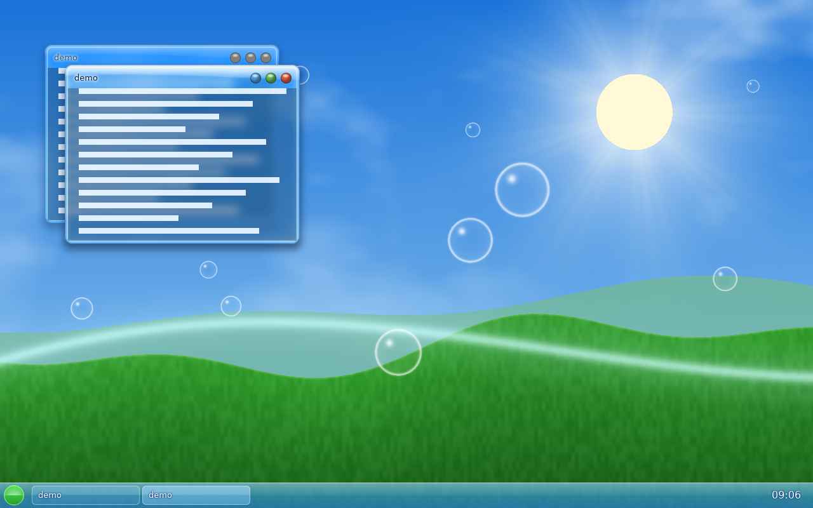
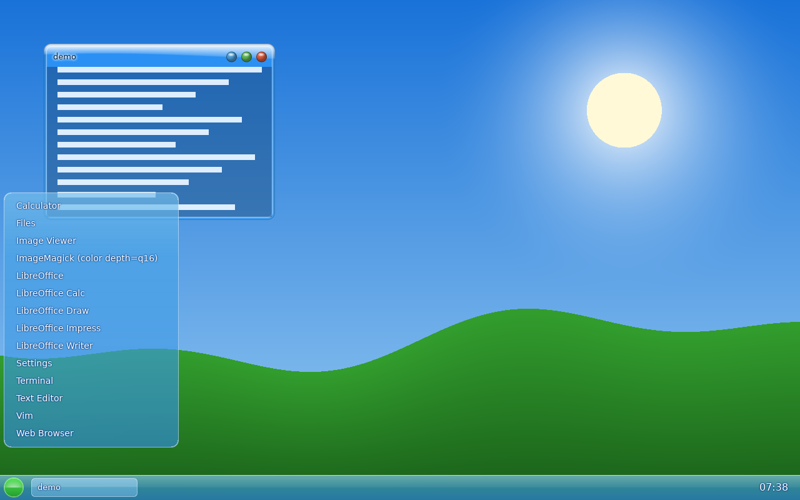
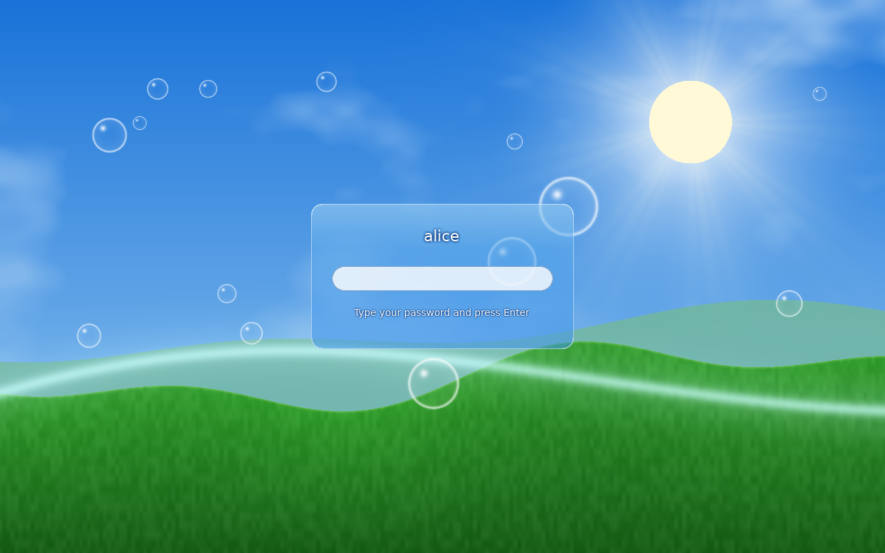
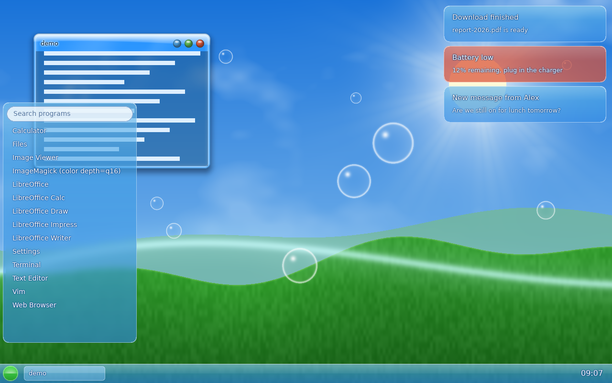
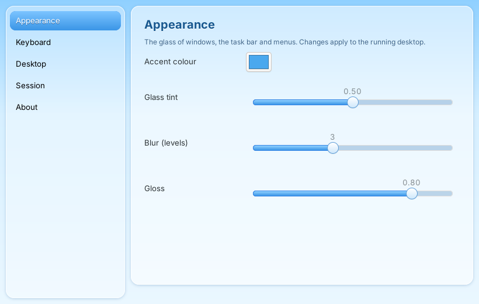

# FAWC

[](https://github.com/L0rdr-ln/FAWC/actions/workflows/build.yml)


A Wayland desktop in the **Frutiger Aero** style: glass windows that really blur what is behind
them, gloss on the title bars, orb buttons, a sky-and-hills wallpaper, a glass task bar and start
menu. The goal is a complete desktop suite the way GNOME or KDE are (compositor, shell, settings,
theme, session), built in stages. Today: the compositor, a task bar with start menu and window
list, and a lock screen.

Written in Rust on [Smithay](https://github.com/Smithay/smithay), **not** on wlroots: wlroots'
scene graph can only stack pictures and rectangles, it cannot read back what is behind a window,
so a true blur is impossible there. FAWC draws the scene bottom to top into an offscreen
texture, and before every glass window it blurs the part of that texture behind the window (dual
Kawase blur), draws the glass panel over it (rounded shape, tint, gloss, light edge) and then
the client. Clients can ask for the same blur behind their own translucent areas with
`ext-background-effect-v1`.



| start menu | lock screen | notifications |
|---|---|---|
|  |  |  |

## What works

| | |
|---|---|
| **Compositor** | xdg-shell windows with server-side glass frames, move / resize / maximize / minimize, focus, popups, keyboard and pointer; layer-shell (panels, launchers, wallpapers) with exclusive zones; `ext-background-effect-v1`; `ext-session-lock-v1`; `wlr-foreign-toplevel-management`; nested (winit) backend and a DRM/KMS backend |
| **Task bar** `fawc-panel` | glass strip with the start orb, a button per open window (click to raise or minimize), clock; blurred behind |
| **Start menu** | the installed applications from `.desktop` files with a search field: type to filter, Up/Down, Enter starts, Esc clears or closes; glass sheet, closes when the pointer leaves |
| **Notifications** `fawc-notify` | the `org.freedesktop.Notifications` service on the session bus (what `notify-send` and every app talks to); glass bubbles at the top right, newest on top, expire on their timeout, critical ones stay, click to dismiss; started with the session when a D-Bus session bus exists |
| **Settings** `fawc-settings` | GTK4 control panel with the FAWC look: accent colour, glass tint, blur, gloss, keyboard layout and repeat, terminal, task bar, idle lock. Every change is written to `fawc.toml` (comments kept, bad values refused) and the running desktop follows at once. Build it with `cargo build -p fawc-settings` (needs `libgtk-4-dev`) |
| **Lock screen** `fawc-lock` | `Alt+L`: a glass login card; the password is checked by PAM's `unix_chkpwd` |
| **Tests** | pixel tests of the glass on a software GL, and end-to-end tests with real Wayland clients (including the real panel and lock programs); no display or GPU needed |

**Not verified:** the DRM/KMS backend (real console / GPU) has been written and compiled but never
run on hardware, multi-monitor, hot-plug, HiDPI, cursor themes, GTK/Qt apps asking for blur.
See [docs/ROADMAP.md](docs/ROADMAP.md).

## Try it

Nested in a window of your current desktop (X11 or Wayland):

```sh
cargo run &                         # opens a window; the task bar starts with it
WAYLAND_DISPLAY=wayland-N cargo run --example demo-client   # N is printed in the log
```

On a console or in a VM (Debian/Ubuntu), one script installs everything and builds:

```sh
sudo apt install -y git
git clone https://github.com/L0rdr-ln/FAWC fawc && fawc/tools/vm-setup.sh
~/start-fawc            # on a console: Ctrl+Alt+F3, log in, then run it
```

On a console FAWC uses the GPU directly (DRM/KMS, libseat, libinput). Please attach
`~/fawc-last.log` to a report if something is wrong.

## Keys

| | |
|---|---|
| **Alt+Return** | terminal (`foot`, or `$FAWC_TERMINAL`) |
| **Alt+drag**, title bar | move; borders resize; the three orbs minimize / maximize / close |
| **Alt+Tab** | cycle windows (**Alt+m** restore a minimized one) |
| **Alt+f**, **Alt+q** | maximize, close |
| **Alt+L** | lock the session |
| **Alt+Esc** | quit FAWC |
| **Ctrl+Alt+F1..F12** | switch console (DRM backend) |

## Configuration



One file, `~/.config/fawc/fawc.toml` (system defaults in `/etc/fawc/fawc.toml`; the user's file
wins key by key), see [docs/fawc.example.toml](docs/fawc.example.toml). It is applied **while
FAWC runs**: change the accent colour, glass strength, blur, terminal, keyboard layout or key
repeat and the desktop follows within half a second; a file with an error is reported in the log
and ignored. A settings app that edits this file is planned ([docs/SETTINGS.md](docs/SETTINGS.md)).

Environment overrides: `FAWC_TERMINAL`, `FAWC_LAUNCHER`, `FAWC_NO_PANEL=1`, `FAWC_NO_NOTIFY=1`, `FAWC_AUTOSTART="cmd"`,
`FAWC_CONFIG=/path/file.toml` (use only this file), `RUST_LOG=info` (logs).

## Build

```sh
sudo apt install pkg-config libudev-dev libseat-dev libinput-dev libgbm-dev libegl-dev \
    libgles-dev libxkbcommon-dev libdrm-dev libwayland-dev
cargo build
LIBGL_ALWAYS_SOFTWARE=1 cargo test        # software GL is enough
cargo run -- glass-demo glass-demo.png    # render the demo scene offscreen
```

## Documents

- [docs/ARCHITECTURE.md](docs/ARCHITECTURE.md): what is written here and what is reused
- [docs/ROADMAP.md](docs/ROADMAP.md): the stages, what is done
- [docs/SETTINGS.md](docs/SETTINGS.md): the plan for the control panel and the one config file
- [CONTRIBUTING.md](CONTRIBUTING.md): building, testing, house rules

## Relation to sfwc

[sfwc](https://github.com/L0rdr-ln/Simple-Floating-Wayland-Compositor) is the small floating
compositor on wlroots. FAWC is a separate project with a different goal (looks first); it reuses
ideas (theme format with a `[style]` section, headless pixel tests), not code.

## Licence

MIT, see [LICENSE](LICENSE). All artwork must be original or freely licensed.
