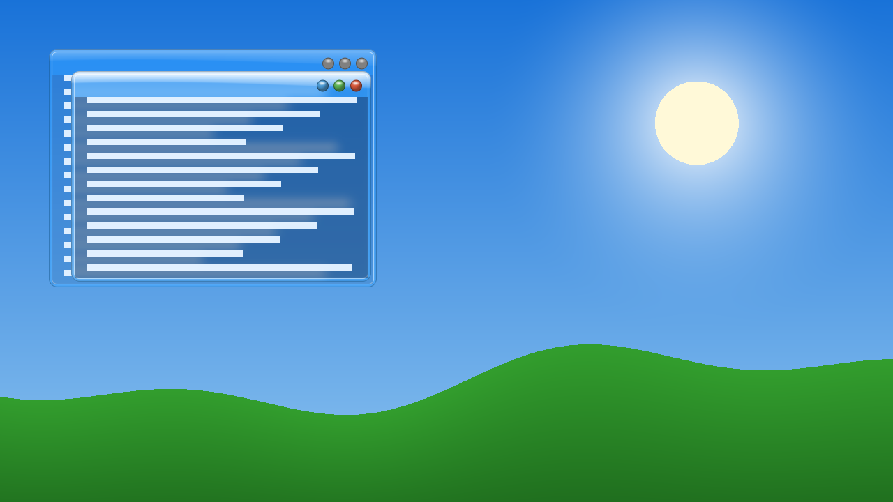

# FAWC

A complete desktop in the Frutiger Aero style (compositor, shell, settings, theme), starting with
a Wayland compositor with **real glass**: the blur behind a window, the gloss on its title bar
and the translucency of its frame are drawn on the GPU by the compositor itself, in the spirit of
Frutiger Aero (Windows Vista/7 Aero, skeuomorphic glass, sky and water).

Written in Rust on [Smithay](https://github.com/Smithay/smithay), **not** on wlroots: wlroots'
scene graph can only stack pictures and rectangles, it cannot read back what is behind a window,
so a true blur is impossible there. FAWC runs its own render pass: it draws the scene bottom to
top into an offscreen texture, and before every glass window it blurs the part of that texture
behind the window (dual Kawase blur), draws the glass panel over it (rounded shape, tint, gloss,
light edge) and then the client.


*`fawc glass-demo`: two glass windows over a sky; the stripes behind them are really blurred.*

## Try it

Nested in a window of your current desktop (X11 or Wayland), with the demo client:

```sh
cargo run &                         # prints WAYLAND_DISPLAY=wayland-N
WAYLAND_DISPLAY=wayland-N cargo run --example demo-client
```

Keys: **Alt+Return** terminal (`foot`, or `$FAWC_TERMINAL`), **Alt+drag** or the title bar to move,
borders to resize, orbs to close / maximize / minimize, **Alt+Tab** cycle, **Alt+m** restore a
minimized window, **Alt+f** maximize, **Alt+q** close, **Alt+Esc** quit.




The task bar (`fawc-panel`) starts with the compositor; click the orb for the start menu (the installed applications). `FAWC_NO_PANEL=1` turns it off.

## Run it on a console or in a VM

```sh
sudo apt install -y git
git clone https://github.com/L0rdr-ln/fawc && fawc/tools/vm-setup.sh   # packages, Rust, build, launcher
~/start-fawc                                                              # on a console: Ctrl+Alt+F3
```

On a console FAWC uses the GPU directly (DRM/KMS, libseat, libinput); inside a desktop it opens as
a window. **The hardware backend is written but has only been compiled, never run on a real
machine yet** (the development environment has no GPU): expect to find problems; please attach
`~/fawc-last.log` to a report. First monitor only, no hot-plug, no cursor themes (a built-in arrow).

## Status

Early. What exists:

- the glass renderer (`src/glass`): blur, glass panel, rounded clipping, as GLES shaders;
- a compositor core: xdg-shell windows with server-side glass frames and orb buttons, focus,
  move / resize / maximize / minimize, popups, keyboard and pointer, a nested (winit) backend;
- an end-to-end test (`tests/e2e.rs`) in which a real Wayland client opens a window and the
  test checks the glass pixels and clicks the orb;
- an offscreen demo (`fawc glass-demo out.png`) and pixel tests that run on a software GL
  (llvmpipe), so the look is developed and checked without a display.

The goal is a full desktop suite, the way GNOME or KDE are: see
[docs/ARCHITECTURE.md](docs/ARCHITECTURE.md) for what is written here and what is reused, and
[docs/ROADMAP.md](docs/ROADMAP.md) for the stages.

## Build

```sh
sudo apt install pkg-config libudev-dev libseat-dev libinput-dev libgbm-dev libegl-dev \
    libgles-dev libxkbcommon-dev libdrm-dev libwayland-dev
cargo build
LIBGL_ALWAYS_SOFTWARE=1 cargo test        # software GL is enough
cargo run -- glass-demo glass-demo.png
```

## Relation to sfwc

[sfwc](https://github.com/L0rdr-ln/Simple-Floating-Wayland-Compositor) is the small floating
compositor on wlroots. FAWC is a separate project with a different goal (looks first); it reuses
ideas (theme format with a `[style]` section, headless pixel tests), not code.
